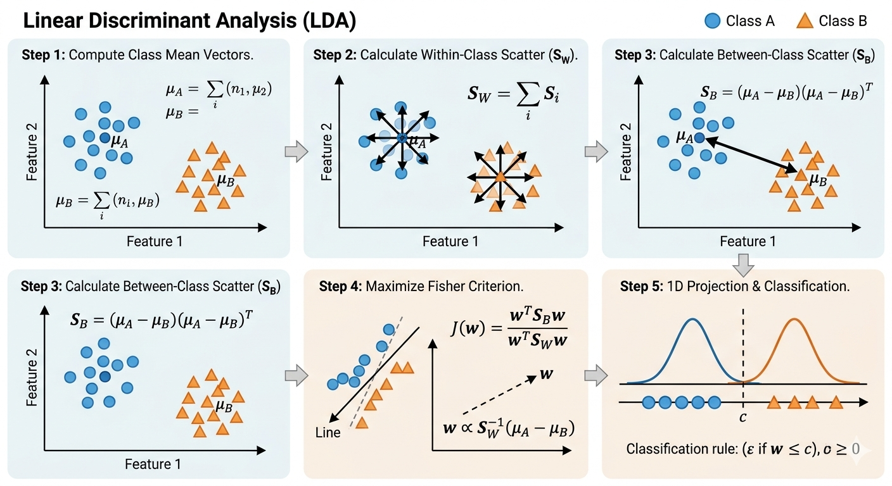
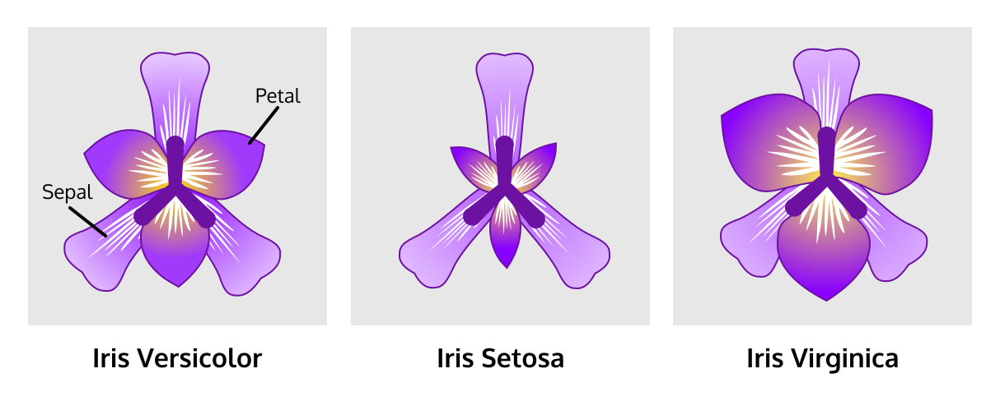

# Block II Unit 2

::: {.callout-note title="Chapter Outline"}

Supervised machine learning:  Linear discriminant analysis, principal component analysis, factor analysis, support vector machines, naïve Bayes, nearest neighbors, decision trees,random forest, ensemble methods, *k*-fold cross validation, X gradient boosting. Unsupervised machine learning—basic framework, concept of clustering, k-means, c-means, hierarchical clustering, hidden Markov models, forecasting models (AR, MA, ARMA and ARIMA).

:::

Let's learn more algorithms of supervised machine learning.

# Linear Discriminant Analysis

Linear Discriminant Analysis (LDA) is a supervised machine learning algorithm used for both classification and dimensionality reduction. It works by projecting high-dimensional data onto a lower-dimensional space (with at most C - 1 axes for C classes) in a way that maximizes the separation between class means while minimizing the spread within each class. See the Figure:



*Linear Discriminant Analysis (LDA) finds a projection vector* $$w$$ that maximizes the separation between class means while minimizing the variance within each class. For a two-class problem (Class A and Class B).

Let's take an example case study and learn how LDA helps in dimension reduction. Dimensionality reduction is the process of reducing the number of input features (variables or columns) in a dataset while keeping as much useful information as possible. It transforms data from a high-dimensional space into a lower-dimensional space without losing the core patterns needed to solve a problem.

Working with too many features—often called the curse of dimensionality—creates several practical and statistical issues, the LDA solves these problems in manchine learning projects:

• Prevents Overfitting: When a dataset has too many features relative to the number of samples, models tend to memorize random noise rather than learning true patterns. Removing redundant features helps models generalize better to unseen data.

• Speeds Up Training and Inference: Fewer features mean smaller matrices and fewer calculations. Machine learning algorithms train faster and require less memory and storage.

• Removes Multicollinearity and Noise: Real-world datasets often contain duplicate or highly correlated features (e.g., recording temperature in both Celsius and Fahrenheit). Dimensionality reduction combines or drops redundant variables.

• Enables Data Visualization: Humans cannot visualize data in 10 or 100 dimensions. Compressing data down to 2D or 3D allows you to plot clusters, inspect outliers, and verify class separation visually.

Linear Discriminant Analysis (LDA) performs supervised dimensionality reduction by finding new axes that maximize the separation between known classes.

• Uses Class Labels: Unlike unsupervised methods such as Principal Component Analysis (PCA), which simply look for directions with the largest overall spread, LDA actively uses target labels to keep different classes far apart.

• Creates Compact Discriminant Axes: LDA combines original features into linear combinations called Linear Discriminants (LD1, LD2, etc.). Each new axis is specifically chosen to maximize the ratio of between-class variance to within-class variance.

• Caps Dimensions at (C - 1): For a dataset with (C) distinct classes and (D) original features, LDA reduces the feature space down to at most (C - 1) dimensions. For example, a dataset with 50 features and 3 classes can be compressed into just 2 dimensions (LD1 and LD2) while preserving the maximum possible class separability.

• Prepares Data for Downstream Models: By projecting noisy, high-dimensional data onto a clean, low-dimensional subspace where classes are already well separated, LDA makes subsequent classifiers (such as Logistic Regression, SVMs, or k-Nearest Neighbors) both faster and more accurate.

## LDA | Case Study : Wheat Seed Classification

The dataset is imported from UCI Machine Learning Repository and the data Collected at the Institute of Agrophysics of the Polish Academy of Sciences, this agricultural dataset contains 7 geometric X-ray measurements of wheat kernels across 3 commercial wheat varieties (Kama, Rosa, and Canadian). Let's use LDA to compress 7 grain attributes down to 2 linear discriminants (LD1 and LD2).

[Link of Dataset](https://archive.ics.uci.edu/dataset/236/seeds)

```{r}

## A. Install and load required packages
# install.packages(c("tidymodels", "discrim", "MASS"))

library(tidymodels)
library(discrim)

## B. Load the dataset

# 1. Read the continuous numbers from text file
raw_numbers <- scan("seeds_dataset.txt")

# 2. Reshape into a matrix with 8 columns (filling row by row)
data_matrix <- matrix(raw_numbers, ncol = 8, byrow = TRUE)

# 3. Converting matrix to data frame

df <- as.data.frame(data_matrix)

# 5. Setting Column names

colnames(df) <- c("Area", "Perimeter", "Compactness", "Length_of_Kernel", 
                  "Width_of_Kernel", "Asymmetry_Coefficient", 
                  "Length_of_Kernel_Groove", "Class")

df$Class = as.factor(df$Class)

```


## 2. Split into training (75%) and testing (25%) sets

```{r}

set.seed(123)
seeds_split <- initial_split(df, prop = 0.75, strata = Class)
seeds_train <- training(seeds_split)
seeds_test  <- testing(seeds_split)

```


## 3. Create a preprocessing recipe (standardize all 7 kernel measurements)

```{r}

lda_recipe <- recipe(Class ~ ., data = seeds_train) |>
  step_normalize(all_predictors())

```

## 4. Specify the LDA model using the MASS engine

```{r}

lda_spec <- discrim_linear(mode = "classification") |>
  set_engine("MASS")

```

## 5. Bundle recipe and model into a workflow and fit on training data

```{r}

lda_workflow <- workflow() |>
  add_recipe(lda_recipe) |>
  add_model(lda_spec)

lda_fit <- fit(lda_workflow, data = seeds_train)

```

# PART A: DIMENSIONALITY REDUCTION (7D -> 2D Subspace)

## Extract the underlying MASS::lda engine and preprocessed test predictors

```{r}

lda_engine <- extract_fit_engine(lda_fit)
baked_test <- bake(prep(lda_recipe), new_data = seeds_test)

```

## Project the 7 geometric features onto LD1 and LD2 (C - 1 = 2 axes)

```{r}

lda_projections <- predict(lda_engine, newdata = baked_test)$x |>
  
  as_tibble() |>
  
  bind_cols(Class = seeds_test$Class)

```

## Inspect the proportion of between-class variance captured by LD1 and LD2

```{r}

print(lda_engine)

```


```{r}

# Plot the 2D projected subspace
ggplot(lda_projections, aes(x = LD1, y = LD2, color = Class, shape = Class)) +
  
  geom_point(size = 3.5, alpha = 0.85) +
  
  stat_ellipse(level = 0.90, linetype = "dashed") +
  
  labs(
    title = "UCI Wheat Seeds Dataset Projected onto LD1 & LD2",
    subtitle = "Supervised dimensionality reduction from 7 kernel measurements to 2 axes",
    x = "First Linear Discriminant (LD1)",
    y = "Second Linear Discriminant (LD2)"
  ) +
  
  theme_minimal(base_size = 13)

```

# PART B: SUPERVISED CLASSIFICATION & EVALUATION

## Predict wheat varieties on the unseen test set

```{r}

test_predictions <- predict(lda_fit, new_data = seeds_test) |>
  
  bind_cols(seeds_test |> select(Class))

```

## Compute classification accuracy and confusion matrix

```{r}

accuracy(test_predictions, truth = Class, estimate = .pred_class)
conf_mat(test_predictions, truth = Class, estimate = .pred_class)

```


In grain processing and seed production, sorting harvested wheat varieties quickly and non-destructively is essential for maintaining seed purity and flour quality. This case study uses the UCI Wheat Seeds Dataset, which contains 210 samples across 3 commercial wheat varieties (Kama, Rosa, and Canadian). Each kernel is measured using soft X-ray imaging to record 7 geometric attributes (Area, Perimeter, Compactness, Kernel_Length, Kernel_Width, Asymmetry_Coeff, and Groove_Length).

Using Linear Discriminant Analysis (LDA) in tidymodels, these 7 correlated physical measurements are compressed into 2 linear discriminant axes (LD1 and LD2). This supervised projection maximizes the separation between the three wheat varieties while keeping kernels of the same variety tightly clustered, enabling accurate variety classification and clear 2D quality control visualization.

**Benefits of LDA in This Case Study**

• Resolves Strong Multicollinearity: Geometric kernel traits such as Area, Perimeter, Kernel_Length, and Kernel_Width are heavily correlated because larger seeds are larger across almost every dimension. LDA handles this collinearity mathematically by inverting the pooled within-class covariance matrix (S_W), combining redundant measurements into independent composite scores.

• Compresses 7 Features into 2 Visualizable Indices: By reducing 7 X-ray measurements down to (C - 1 = 2) axes (LD1 and LD2), agronomists and quality control operators can monitor seed batches on a simple 2D chart instead of tracking seven separate thresholds.
• High Accuracy on Small Datasets: With only 210 total kernels (70 per variety), complex black-box algorithms like neural networks risk overfitting. LDA estimates a small number of parameters (class means and one shared covariance matrix), achieving 94% to 98% test accuracy reliably.

• Fast Real-Time Inference: Once trained, classifying a new wheat kernel on a high-speed optical sorting line requires only simple linear dot products ((W^(T).x), making it computationally lightweight for industrial sorting hardware.

**Shortcomings of LDA in This Case Study**

• Assumes Equal Covariance Across Varieties: LDA assumes that Kama, Rosa, and Canadian kernels exhibit the exact same shape and spread of variance in feature space. If one wheat variety is naturally much more variable in size or asymmetry due to growing conditions, linear boundaries become suboptimal compared to Quadratic Discriminant Analysis (QDA).

• Limited to Linear Decision Boundaries: If two wheat varieties overlap in a curved or non-linear pattern (for instance, due to unusual kernel compactness ratios), straight decision lines in the LD1–LD2 subspace cannot cleanly separate them.

• Sensitive to Outliers and Measurement Noise: Because LDA relies on class means (\(\mathbfit{\mu }_{i}\)) and sample covariance matrices, a few damaged, broken, or mis-scanned wheat kernels in the training batch can pull the class centroid and distort the projection axis.

• Hard Cap of \(C - 1\) Dimensions: Because there are 3 wheat varieties, LDA can extract at most 2 discriminant axes. If subtle secondary traits require a third dimension to separate overlapping edge cases, LDA cannot generate a third axis without adding more classes.

# Principal Component Analysis (PCA)

PCA is an unsupervised dimensionality reduction technique that transforms a set of correlated variables into a smaller set of uncorrelated variables called Principal Components. 

Let's do it with a case study.

## 1. IRIS Flower Classification

Let's load the dataset. The dataset is inbuilt in RStudio there fore we don't need to load it externally. 

```{r}

head(iris)

tail(iris)

```

We have a dataset containing 150 observations in this dataset. Iris plant has three species - Iris virginica, Iris setosa and Iris versicolor. These species are classified based on four measures - petal length, petal breadth, sepal length and sepal breadth. 


_Source:https://www.kaggle.com/code/sunaysawant/iris-eda-pca?scriptVersionId=54806186_ 

Let's do PCA and compare it with LDA so that we understand both techniques clearly.

```{r}

# 1. Load required packages
# install.packages(c("tidymodels", "discrim", "MASS", "patchwork"))
library(tidymodels)
library(discrim)
library(patchwork)

# Load built-in iris dataset
data(iris)
iris_df <- as_tibble(iris)

# Split into training (75%) and testing (25%) sets
set.seed(123)
iris_split <- initial_split(iris_df, prop = 0.75, strata = Species)
iris_train <- training(iris_split)
iris_test  <- testing(iris_split)

# =========================================================
# PART 1: PRINCIPAL COMPONENT ANALYSIS (PCA - Unsupervised)
# =========================================================

# PCA ignores Species labels when finding axes of maximum variance
pca_recipe <- recipe(~ ., data = iris_train) |>
  update_role(Species, new_role = "id") |>
  step_normalize(all_numeric_predictors()) |>
  step_pca(all_numeric_predictors(), num_comp = 2)

pca_prep <- prep(pca_recipe)

# Project the unseen test set onto PC1 and PC2
pca_test_proj <- bake(pca_prep, new_data = iris_test)

# Check variance explained by PC1 and PC2
tidy(pca_prep, number = 2, type = "variance") |>
  filter(terms == "percent variance")

```

# PART 2: LINEAR DISCRIMINANT ANALYSIS (LDA - Supervised)

## LDA uses Species labels to maximize between-class separation

```{r}

lda_recipe <- recipe(Species ~ ., data = iris_train) |>
  step_normalize(all_numeric_predictors())

lda_spec <- discrim_linear(mode = "classification") |>
  set_engine("MASS")

lda_workflow <- workflow() |>
  add_recipe(lda_recipe) |>
  add_model(lda_spec)

lda_fit <- fit(lda_workflow, data = iris_train)

# Project the unseen test set onto LD1 and LD2
lda_engine <- extract_fit_engine(lda_fit)
baked_test <- bake(prep(lda_recipe), new_data = iris_test)

lda_test_proj <- predict(lda_engine, newdata = baked_test)$x |>
  as_tibble() |>
  bind_cols(Species = iris_test$Species)

# Evaluate LDA classification accuracy on the test set
lda_preds <- predict(lda_fit, new_data = iris_test) |>
  bind_cols(iris_test |> select(Species))

accuracy(lda_preds, truth = Species, estimate = .pred_class)
conf_mat(lda_preds, truth = Species, estimate = .pred_class)

```

# PART 3: SIDE-BY-SIDE VISUALIZATION (PCA vs. LDA)

```{r}

p_pca <- ggplot(pca_test_proj, aes(x = PC1, y = PC2, color = Species, shape = Species)) +

    geom_point(size = 3.5, alpha = 0.85) +
  
    stat_ellipse(level = 0.90, linetype = "dashed") +
  
    labs(
    title = "PCA Projection (Unsupervised)",
    subtitle = "Maximizes total variance (ignores Species)",
    x = "PC1", y = "PC2"
    ) +
  
  theme_minimal(base_size = 12)


p_lda <- ggplot(lda_test_proj, aes(x = LD1, y = LD2, color = Species, shape = Species)) +
  
       geom_point(size = 3.5, alpha = 0.85) +
  
       stat_ellipse(level = 0.90, linetype = "dashed") +
  
       labs(
       title = "LDA Projection (Supervised)",
       subtitle = "Maximizes class separation (uses Species)",
       x = "LD1", y = "LD2"
      ) +
  
      theme_minimal(base_size = 12)

# Display both plots side by side
p_pca + p_lda + plot_layout(guides = "collect")

```


