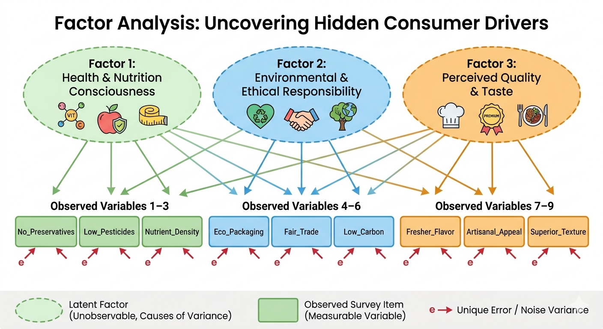

# Block II Unit 2

::: {.callout-note title="Chapter Outline"}

Supervised machine learning:  Linear discriminant analysis, principal component analysis, factor analysis, support vector machines, naïve Bayes, nearest neighbors, decision trees,random forest, ensemble methods, *k*-fold cross validation, X gradient boosting. Unsupervised machine learning—basic framework, concept of clustering, k-means, c-means, hierarchical clustering, hidden Markov models, forecasting models (AR, MA, ARMA and ARIMA).

:::

Let's learn more algorithms of supervised machine learning.

## Linear Discriminant Analysis

Linear Discriminant Analysis (LDA) is a supervised machine learning algorithm used for both classification and dimensionality reduction. It works by projecting high-dimensional data onto a lower-dimensional space (with at most C - 1 axes for C classes) in a way that maximizes the separation between class means while minimizing the spread within each class. See the Figure:


*Linear Discriminant Analysis (LDA) finds a projection vector* $$w$$ that maximizes the separation between class means while minimizing the variance within each class. For a two-class problem (Class A and Class B).

Let's take an example case study and learn how LDA helps in dimension reduction. Dimensionality reduction is the process of reducing the number of input features (variables or columns) in a dataset while keeping as much useful information as possible. It transforms data from a high-dimensional space into a lower-dimensional space without losing the core patterns needed to solve a problem.

Working with too many features—often called the curse of dimensionality—creates several practical and statistical issues, the LDA solves these problems in manchine learning projects:

• Prevents Overfitting: When a dataset has too many features relative to the number of samples, models tend to memorize random noise rather than learning true patterns. Removing redundant features helps models generalize better to unseen data.

• Speeds Up Training and Inference: Fewer features mean smaller matrices and fewer calculations. Machine learning algorithms train faster and require less memory and storage.

• Removes Multicollinearity and Noise: Real-world datasets often contain duplicate or highly correlated features (e.g., recording temperature in both Celsius and Fahrenheit). Dimensionality reduction combines or drops redundant variables.

• Enables Data Visualization: Humans cannot visualize data in 10 or 100 dimensions. Compressing data down to 2D or 3D allows you to plot clusters, inspect outliers, and verify class separation visually.

Linear Discriminant Analysis (LDA) performs supervised dimensionality reduction by finding new axes that maximize the separation between known classes.

• Uses Class Labels: Unlike unsupervised methods such as Principal Component Analysis (PCA), which simply look for directions with the largest overall spread, LDA actively uses target labels to keep different classes far apart.

• Creates Compact Discriminant Axes: LDA combines original features into linear combinations called Linear Discriminants (LD1, LD2, etc.). Each new axis is specifically chosen to maximize the ratio of between-class variance to within-class variance.

• Caps Dimensions at (C - 1): For a dataset with (C) distinct classes and (D) original features, LDA reduces the feature space down to at most (C - 1) dimensions. For example, a dataset with 50 features and 3 classes can be compressed into just 2 dimensions (LD1 and LD2) while preserving the maximum possible class separability.

• Prepares Data for Downstream Models: By projecting noisy, high-dimensional data onto a clean, low-dimensional subspace where classes are already well separated, LDA makes subsequent classifiers (such as Logistic Regression, SVMs, or k-Nearest Neighbors) both faster and more accurate.

### LDA | Case Study : Wheat Seed Classification

The dataset is imported from UCI Machine Learning Repository and the data Collected at the Institute of Agrophysics of the Polish Academy of Sciences, this agricultural dataset contains 7 geometric X-ray measurements of wheat kernels across 3 commercial wheat varieties (Kama, Rosa, and Canadian). Let's use LDA to compress 7 grain attributes down to 2 linear discriminants (LD1 and LD2).

[Link of Dataset](https://archive.ics.uci.edu/dataset/236/seeds)

```{r}

## A. Install and load required packages
# install.packages(c("tidymodels", "discrim", "MASS"))

library(tidymodels)
library(discrim)

## B. Load the dataset

# 1. Read the continuous numbers from text file
raw_numbers <- scan("seeds_dataset.txt")

# 2. Reshape into a matrix with 8 columns (filling row by row)
data_matrix <- matrix(raw_numbers, ncol = 8, byrow = TRUE)

# 3. Converting matrix to data frame

df <- as.data.frame(data_matrix)

# 5. Setting Column names

colnames(df) <- c("Area", "Perimeter", "Compactness", "Length_of_Kernel", 
                  "Width_of_Kernel", "Asymmetry_Coefficient", 
                  "Length_of_Kernel_Groove", "Class")

df$Class = as.factor(df$Class)

```


### 2. Split into training (75%) and testing (25%) sets

```{r}

set.seed(123)
seeds_split <- initial_split(df, prop = 0.75, strata = Class)
seeds_train <- training(seeds_split)
seeds_test  <- testing(seeds_split)

```


### 3. Create a preprocessing recipe (standardize all 7 kernel measurements)

```{r}

lda_recipe <- recipe(Class ~ ., data = seeds_train) |>
  step_normalize(all_predictors())

```

### 4. Specify the LDA model using the MASS engine

```{r}

lda_spec <- discrim_linear(mode = "classification") |>
  set_engine("MASS")

```

### 5. Bundle recipe and model into a workflow and fit on training data

```{r}

lda_workflow <- workflow() |>
  add_recipe(lda_recipe) |>
  add_model(lda_spec)

lda_fit <- fit(lda_workflow, data = seeds_train)

```

### PART A: DIMENSIONALITY REDUCTION (7D -> 2D Subspace)

### Extract the underlying MASS::lda engine and preprocessed test predictors

```{r}

lda_engine <- extract_fit_engine(lda_fit)
baked_test <- bake(prep(lda_recipe), new_data = seeds_test)

```

### Project the 7 geometric features onto LD1 and LD2 (C - 1 = 2 axes)

```{r}

lda_projections <- predict(lda_engine, newdata = baked_test)$x |>
  
  as_tibble() |>
  
  bind_cols(Class = seeds_test$Class)

```

### Inspect the proportion of between-class variance captured by LD1 and LD2

```{r}

print(lda_engine)

```


```{r}

# Plot the 2D projected subspace
ggplot(lda_projections, aes(x = LD1, y = LD2, color = Class, shape = Class)) +
  
  geom_point(size = 3.5, alpha = 0.85) +
  
  stat_ellipse(level = 0.90, linetype = "dashed") +
  
  labs(
    title = "UCI Wheat Seeds Dataset Projected onto LD1 & LD2",
    subtitle = "Supervised dimensionality reduction from 7 kernel measurements to 2 axes",
    x = "First Linear Discriminant (LD1)",
    y = "Second Linear Discriminant (LD2)"
  ) +
  
  theme_minimal(base_size = 13)

```

### PART B: SUPERVISED CLASSIFICATION & EVALUATION

### Predict wheat varieties on the unseen test set

```{r}

test_predictions <- predict(lda_fit, new_data = seeds_test) |>
  
  bind_cols(seeds_test |> select(Class))

```

### Compute classification accuracy and confusion matrix

```{r}

accuracy(test_predictions, truth = Class, estimate = .pred_class)
conf_mat(test_predictions, truth = Class, estimate = .pred_class)

```


In grain processing and seed production, sorting harvested wheat varieties quickly and non-destructively is essential for maintaining seed purity and flour quality. This case study uses the UCI Wheat Seeds Dataset, which contains 210 samples across 3 commercial wheat varieties (Kama, Rosa, and Canadian). Each kernel is measured using soft X-ray imaging to record 7 geometric attributes (Area, Perimeter, Compactness, Kernel_Length, Kernel_Width, Asymmetry_Coeff, and Groove_Length).

Using Linear Discriminant Analysis (LDA) in tidymodels, these 7 correlated physical measurements are compressed into 2 linear discriminant axes (LD1 and LD2). This supervised projection maximizes the separation between the three wheat varieties while keeping kernels of the same variety tightly clustered, enabling accurate variety classification and clear 2D quality control visualization.

**Benefits of LDA in This Case Study**

• Resolves Strong Multicollinearity: Geometric kernel traits such as Area, Perimeter, Kernel_Length, and Kernel_Width are heavily correlated because larger seeds are larger across almost every dimension. LDA handles this collinearity mathematically by inverting the pooled within-class covariance matrix (S_W), combining redundant measurements into independent composite scores.

• Compresses 7 Features into 2 Visualizable Indices: By reducing 7 X-ray measurements down to (C - 1 = 2) axes (LD1 and LD2), agronomists and quality control operators can monitor seed batches on a simple 2D chart instead of tracking seven separate thresholds.
• High Accuracy on Small Datasets: With only 210 total kernels (70 per variety), complex black-box algorithms like neural networks risk overfitting. LDA estimates a small number of parameters (class means and one shared covariance matrix), achieving 94% to 98% test accuracy reliably.

• Fast Real-Time Inference: Once trained, classifying a new wheat kernel on a high-speed optical sorting line requires only simple linear dot products ((W^(T).x), making it computationally lightweight for industrial sorting hardware.

**Shortcomings of LDA in This Case Study**

• Assumes Equal Covariance Across Varieties: LDA assumes that Kama, Rosa, and Canadian kernels exhibit the exact same shape and spread of variance in feature space. If one wheat variety is naturally much more variable in size or asymmetry due to growing conditions, linear boundaries become suboptimal compared to Quadratic Discriminant Analysis (QDA).

• Limited to Linear Decision Boundaries: If two wheat varieties overlap in a curved or non-linear pattern (for instance, due to unusual kernel compactness ratios), straight decision lines in the LD1–LD2 subspace cannot cleanly separate them.

• Sensitive to Outliers and Measurement Noise: Because LDA relies on class means (\(\mathbfit{\mu }_{i}\)) and sample covariance matrices, a few damaged, broken, or mis-scanned wheat kernels in the training batch can pull the class centroid and distort the projection axis.

• Hard Cap of \(C - 1\) Dimensions: Because there are 3 wheat varieties, LDA can extract at most 2 discriminant axes. If subtle secondary traits require a third dimension to separate overlapping edge cases, LDA cannot generate a third axis without adding more classes.

## Principal Component Analysis (PCA)

PCA is an unsupervised dimensionality reduction technique that transforms a set of correlated variables into a smaller set of uncorrelated variables called Principal Components. 

Let's do it with a case study.

### 1. IRIS Flower Classification

Let's load the dataset. The dataset is inbuilt in RStudio there fore we don't need to load it externally. 

```{r}

head(iris)

tail(iris)

```

We have a dataset containing 150 observations in this dataset. Iris plant has three species - Iris virginica, Iris setosa and Iris versicolor. These species are classified based on four measures - petal length, petal breadth, sepal length and sepal breadth. 


_Source:https://www.kaggle.com/code/sunaysawant/iris-eda-pca?scriptVersionId=54806186_ 

Let's do PCA and compare it with LDA so that we understand both techniques clearly.

```{r}

# 1. Load required packages
# install.packages(c("tidymodels", "discrim", "MASS", "patchwork"))
library(tidymodels)
library(discrim)
library(patchwork)

# Load built-in iris dataset
data(iris)
iris_df <- as_tibble(iris)

# Split into training (75%) and testing (25%) sets
set.seed(123)
iris_split <- initial_split(iris_df, prop = 0.75, strata = Species)
iris_train <- training(iris_split)
iris_test  <- testing(iris_split)

# =========================================================
# PART 1: PRINCIPAL COMPONENT ANALYSIS (PCA - Unsupervised)
# =========================================================

# PCA ignores Species labels when finding axes of maximum variance
pca_recipe <- recipe(~ ., data = iris_train) |>
  update_role(Species, new_role = "id") |>
  step_normalize(all_numeric_predictors()) |>
  step_pca(all_numeric_predictors(), num_comp = 2)

pca_prep <- prep(pca_recipe)

# Project the unseen test set onto PC1 and PC2
pca_test_proj <- bake(pca_prep, new_data = iris_test)

# Check variance explained by PC1 and PC2
tidy(pca_prep, number = 2, type = "variance") |>
  filter(terms == "percent variance")

```

### PART 2: LINEAR DISCRIMINANT ANALYSIS (LDA - Supervised)

### LDA uses Species labels to maximize between-class separation

```{r}

lda_recipe <- recipe(Species ~ ., data = iris_train) |>
  step_normalize(all_numeric_predictors())

lda_spec <- discrim_linear(mode = "classification") |>
  set_engine("MASS")

lda_workflow <- workflow() |>
  add_recipe(lda_recipe) |>
  add_model(lda_spec)

lda_fit <- fit(lda_workflow, data = iris_train)

# Project the unseen test set onto LD1 and LD2
lda_engine <- extract_fit_engine(lda_fit)
baked_test <- bake(prep(lda_recipe), new_data = iris_test)

lda_test_proj <- predict(lda_engine, newdata = baked_test)$x |>
  as_tibble() |>
  bind_cols(Species = iris_test$Species)

# Evaluate LDA classification accuracy on the test set
lda_preds <- predict(lda_fit, new_data = iris_test) |>
  bind_cols(iris_test |> select(Species))

accuracy(lda_preds, truth = Species, estimate = .pred_class)
conf_mat(lda_preds, truth = Species, estimate = .pred_class)

```

### PART 3: SIDE-BY-SIDE VISUALIZATION (PCA vs. LDA)

```{r}

p_pca <- ggplot(pca_test_proj, aes(x = PC1, y = PC2, color = Species, shape = Species)) +

    geom_point(size = 3.5, alpha = 0.85) +
  
    stat_ellipse(level = 0.90, linetype = "dashed") +
  
    labs(
    title = "PCA Projection (Unsupervised)",
    subtitle = "Maximizes total variance (ignores Species)",
    x = "PC1", y = "PC2"
    ) +
  
  theme_minimal(base_size = 12)


p_lda <- ggplot(lda_test_proj, aes(x = LD1, y = LD2, color = Species, shape = Species)) +
  
       geom_point(size = 3.5, alpha = 0.85) +
  
       stat_ellipse(level = 0.90, linetype = "dashed") +
  
       labs(
       title = "LDA Projection (Supervised)",
       subtitle = "Maximizes class separation (uses Species)",
       x = "LD1", y = "LD2"
      ) +
  
      theme_minimal(base_size = 12)

# Display both plots side by side
p_pca + p_lda + plot_layout(guides = "collect")

```


## Factor Analysis

Factor Analysis is an unsupervised statistical method that uncovers hidden, unobservable variables—called latent factors—that explain why multiple observed variables correlate with one another. 



We create a hypothetical dataset of customer reviews on the food preferences. We simulate a 500-shopper organic food survey (9 items, 1-7 scale).

```{r}

library(tidymodels)
library(psych)

set.seed(2026)
n <- 500

# Create 3 true latent consumer drivers
health_drive  <- rnorm(n)
eco_drive     <- rnorm(n)
quality_drive <- rnorm(n)

# Generate 9 observed survey items driven by the 3 latent factors + noise
survey_df <- tibble(
  No_Preservatives  = round(pmin(pmax(4 + 1.2 * health_drive  + rnorm(n, 0, 0.6), 1), 7)),
  Low_Pesticides    = round(pmin(pmax(4 + 1.3 * health_drive  + rnorm(n, 0, 0.6), 1), 7)),
  Nutrient_Density  = round(pmin(pmax(4 + 1.1 * health_drive  + rnorm(n, 0, 0.7), 1), 7)),
  Eco_Packaging     = round(pmin(pmax(4 + 1.3 * eco_drive     + rnorm(n, 0, 0.6), 1), 7)),
  Fair_Trade        = round(pmin(pmax(4 + 1.2 * eco_drive     + rnorm(n, 0, 0.6), 1), 7)),
  Low_Carbon        = round(pmin(pmax(4 + 1.1 * eco_drive     + rnorm(n, 0, 0.7), 1), 7)),
  Fresher_Flavor    = round(pmin(pmax(4 + 1.2 * quality_drive + rnorm(n, 0, 0.6), 1), 7)),
  Artisanal_Appeal  = round(pmin(pmax(4 + 1.1 * quality_drive + rnorm(n, 0, 0.7), 1), 7)),
  Superior_Texture  = round(pmin(pmax(4 + 1.3 * quality_drive + rnorm(n, 0, 0.6), 1), 7))
)

head(survey_df)

```

### PART A: SUITABILITY CHECKS (KMO & BARTLETT'S TEST)

KMO Test is used to check the suitability of the dataset for factor analysis. When KMO statistic value is more than 0.60, we can proceed with Factor Analysis.

```{r}

# KMO > 0.60 confirms strong shared variance suitable for Factor Analysis
KMO(survey_df)

```

We also need to check the correlation between the variable is significantly differs from identity. 

```{r}
# Bartlett's test checks if correlation matrix differs significantly from identity
cortest.bartlett(cor(survey_df), n = nrow(survey_df))

```

### PART B: DETERMINE OPTIMAL NUMBER OF FACTORS

We create Scree-plot to determine number of factors optimal to explain the variance. 

```{r}

## Parallel analysis compares real eigenvalues against random noise
fa.parallel(survey_df, fm = "ml", fa = "fa")

```


### PART C: FIT EXPLORATORY FACTOR ANALYSIS (3 FACTORS)

From the scree-plot, we see the angle of the line suddenly changes at the factor number 3. We build 3 Factor model:

```{r}

# Use Maximum Likelihood ("ml") with Varimax orthogonal rotation
fa_model <- fa(survey_df, nfactors = 3, rotate = "varimax", fm = "ml")

# Print factor loadings (hide small loadings < 0.30 for clarity)
print(fa_model$loadings, cutoff = 0.30)

```

Let's see 3 Factor Model visually:

```{r}

# Visualize the latent factor structure diagram
fa.diagram(fa_model, main = "Latent Factors Driving Organic Food Purchases", rsize = 0.9)

```

Now, we can classify each shopper according to the strength of each Factor (ML1, ML2, and ML3) and use this score to promote the products accordingly. 

```{r}

# Extract the 3 standardized factor scores per shopper for downstream segmentation
shopper_scores <- as_tibble(fa_model$scores)
head(shopper_scores)

```


:::{.callout-important title = "Assignment Block II Unit 2"}

Use R-inbuilt dataset - `Harman74.cor$cov` dataset, extract plausible factors, name the factors appropriately, give scores to each row and interpret scores of five rows randomly selected.     

Harman74.cor$cov is a 24 × 24 correlation matrix representing 24 psychological aptitude tests administered to 145 seventh- and eighth-grade students by Karl Holzinger and Frances Swineford. 

Breakdown of All 24 Variables by Cognitive Domain:

1. Spatial Ability Tests (Tests 1–4)

These four tests measure how well a student can visualize, rotate, and manipulate 2D and 3D shapes mentally:

• VisualPerception: Identifying matching geometric figures and spatial patterns.

• Cubes: Determining whether two drawings show the same 3D cube rotated into a different position.

• PaperFormBoard: Visualizing how flat, cut-out geometric pieces fit together to form a complete shape.

• Flags: Recognizing whether rotated flag designs match a target orientation or are mirror-reversed. 

2. Verbal Ability Tests (Tests 5–9)

These five tests evaluate vocabulary, reading comprehension, and general knowledge: 

• GeneralInformation: Answering factual questions across everyday general knowledge topics.

• PargraphComprehension: Reading short passages and answering questions about their meaning (spelled without the second "a" in the R dataset).

• SentenceCompletion: Choosing the best word to fill in a blank within a sentence.

• WordClassification: Identifying which word does not belong in a group of related words.

• WordMeaning: Matching target vocabulary words to their correct definitions or synonyms. 

3. Perceptual Speed & Clerical Tests (Tests 10–13)

These four timed tests measure how quickly and accurately a student can perform simple visual-numerical tasks: 

• Addition: Solving basic multi-digit addition problems rapidly.

• Code: Translating symbols or letters into numbers using a provided substitution key.

• CountingDots: Quickly counting clusters of dots arranged in irregular patterns.

• StraightCurvedCapitals: Scanning capital letters to distinguish those made solely of straight lines from those containing curves. 

4. Memory & Associative Recall Tests (Tests 14–19)

These six tests measure short-term recognition and paired-associate recall: 

• WordRecognition: Identifying previously studied words from a mixed list.

• NumberRecognition: Identifying previously studied multi-digit numbers from a mixed list.

• FigureRecognition: Identifying previously shown abstract shapes from a larger set.

• ObjectNumber: Recalling the number paired with a specific object name shown earlier.

• NumberFigure: Recalling the geometric shape paired with a specific number shown earlier.

• FigureWord: Recalling the word paired with a specific abstract figure shown earlier. 

5. Deductive & Mathematical Reasoning Tests (Tests 20–24)

These five tests measure logical deduction, pattern completion, and quantitative problem solving:

• Deduction: Drawing valid logical conclusions from formal premises or syllogisms.

• NumericalPuzzles: Finding missing numbers in arithmetic grids or mathematical puzzles.

• ProblemReasoning: Solving multi-step logical and analytical word puzzles.

• SeriesCompletion: Determining the next number or element in a mathematical sequence.

• ArithmeticProblems: Solving quantitative math word problems. 

:::

## Multiple Machine Learning Models and Ensemble Models

So far, we have understood how to apply single model on the dataset. Now, we apply multiple models on same dataset. We will cover support vector machines, naïve Bayes, nearest neighbors, decision trees,random forest, and ensemble methods. To improve model performance, we will also use k-fold validation and gradient boosting algorithm. 

In commercial agriculture and food processing, dried pulses like dry beans must be accurately sorted by variety before packaging and export because different varieties have distinct cooking times, textures, and market prices. Manual sorting is slow and prone to human error.

Using the UCI Dry Bean Dataset (13,611 grains captured via high-resolution computer vision across 16 morphological and shape features—such as Area, Perimeter, Eccentricity, Roundness, and ShapeFactor1—and 7 commercial bean varieties: Seker, Barbunya, Bombay, Cali, Horoz, Sira, and Dermason), an agribusiness builds a multi-model machine learning benchmark in tidymodels.

To ensure fair comparison without overfitting, all 6 individual classifiers are evaluated using 5-fold stratified cross-validation, and the top performers are combined into a stacked ensemble meta-model that achieves superior grading accuracy.

The difference among the various models is shown in the table:


| Method / Model | Role in This Agribusiness Case Study | Key Trade-Offs |
| :--- | :--- | :--- |
| ***k*-Fold Cross-Validation** | Splits training data into **5 stratified folds**, training on 4 folds and validating on 1 fold repeatedly to measure true generalization across bean batches. | Prevents data leakage and overfitting, though it multiplies training time by *k*. |
| **Naïve Bayes** | Establishes a fast probabilistic baseline assuming all 16 shape measurements are conditionally independent given the bean variety. | Trains in milliseconds, but accuracy suffers because geometric traits (`Area`, `Perimeter`) are strongly correlated. |
| ***k*-Nearest Neighbors (kNN)** | Classifies each bean based on the majority vote of its **7 closest neighbors** in standardized 16D shape space. | Captures irregular local boundaries well, but slows down during real-time sorting line inference. |
| **Decision Tree** | Builds transparent, human-readable **if-then rules** (e.g., *If Area > 70,000 and AspectRatio > 1.8 → Horoz*) for quality control auditors. | Easy to explain to non-technical operators, but single trees overfit noisy seed measurements. |
| **Support Vector Machine (SVM)** | Uses a **Radial Basis Function (RBF) kernel** to draw smooth, non-linear margin boundaries separating overlapping varieties like *Sira* and *Dermason*. | Excels in high-dimensional continuous spaces, but requires strict feature scaling and longer training times. |
| **Random Forest** | Averages predictions across **300 decorrelated decision trees** (bagging + random feature subsets), dramatically reducing variance. | Highly accurate and robust to outliers, though less interpretable than a single tree. |
| **XGBoost (Extreme Gradient Boosting)** | Sequentially builds **300 boosted trees**, where each new tree specifically corrects the misclassified beans from previous trees. | Typically delivers the highest single-model accuracy on tabular shape features, but requires careful tuning. |
| **Ensemble Stacking (`stacks`)** | Trains a regularized **meta-learner** that combines out-of-fold probability predictions from **Random Forest**, **XGBoost**, and **SVM**. | Outperforms every individual model by blending tree-based splits with smooth kernel margins. |

Let's do the R Coding for building multi models. Begin with loading the dataset:

```{r , cache=TRUE}

# 1. Install and load required packages
# install.packages(c(
#   "tidymodels", "discrim", "naivebayes", "kknn",
#   "kernlab", "ranger", "xgboost", "stacks", "readxl"
# ))
library(tidymodels)
library(discrim)
library(stacks)
library(readxl)
library(naivebayes)

# 2. Load the dataset

beans_raw <- read_excel("Dry_Bean_Dataset.xlsx") |>
  mutate(Class = factor(Class))

head(beans_raw)

```

In the dataset, we have more than 13,611 rows. To process such huge data for multiple models with cross validation needs higher computing power. Therefore, ensure enough RAM space in the system. 

```{r , cache=TRUE}

set.seed(202)

# 3. Train / Test Split (80% Train, 20% Test) & 5-Fold Stratified Cross-Validation
bean_split <- initial_split(beans_raw, prop = 0.80, strata = Class)
bean_train <- training(bean_split)
bean_test  <- testing(bean_split)

paste("Number of observations in train data: ",nrow(bean_train))

paste("Number of observations in test data: ",nrow(bean_test))

```

Let's set up cross validation. Cross validation basically, runs the machine learning process multiple times using a random sample selection process. 

```{r , cache=TRUE}

set.seed(2026)

bean_folds <- vfold_cv(bean_train, v = 5, strata = Class)

bean_folds

```

Now data is ready, we can start building multiple machine learning models using tidymodels package:

```{r , cache=TRUE}

# 4. Preprocessing Recipe (Standardize predictors for SVM & kNN)
bean_recipe <- recipe(Class ~ ., data = bean_train) |>
  step_zv(all_predictors()) |>
  step_normalize(all_numeric_predictors())

```

## PART A: DEFINE ALL 6 INDIVIDUAL MODEL SPECIFICATIONS

We build six different models - Naive Bayes, kNN, Decision Tree, Support Vector Machine, Random Forest and XGBoost. Each model captures the relationship between decision variable and predictors in different way. Each model gives prediction in different way and the predictions may differ with other models. Each model improves the prediction errors through five fold cross-validation. 

Once each model produces the predictions, we build a final model that uses the predictions of each model to build final predictions. There are various methods like average of the predictions, voting based predicitons, etc. 

Let's start with building each model:

```{r , cache=TRUE}

### 1. Naive Bayes
nb_spec <- naive_Bayes() |>
  set_engine("naivebayes") |>
  set_mode("classification")

# 2. k-Nearest Neighbors (kNN)
knn_spec <- nearest_neighbor(neighbors = 7) |>
  set_engine("kknn") |>
  set_mode("classification")

# 3. Decision Tree
dt_spec <- decision_tree(cost_complexity = 0.001, tree_depth = 10) |>
  set_engine("rpart") |>
  set_mode("classification")

# 4. Support Vector Machine (RBF Kernel)
svm_spec <- svm_rbf(cost = 2, rbf_sigma = 0.05) |>
  set_engine("kernlab") |>
  set_mode("classification")

# 5. Random Forest (Bagging Ensemble)
rf_spec <- rand_forest(trees = 300, mtry = 4) |>
  set_engine("ranger") |>
  set_mode("classification")

# 6. XGBoost (Gradient Boosting Ensemble)
xgb_spec <- boost_tree(trees = 300, tree_depth = 6, learn_rate = 0.05) |>
  set_engine("xgboost") |>
  set_mode("classification")

```


## PART B: EVALUATE ALL MODELS WITH 5-FOLD CROSS-VALIDATION

After setting up the recipes of each model, we set the workflow for 5 fold cross validation:

```{r , cache=TRUE}

### Bundle all 6 models into a single workflow_set
bean_workflows <- workflow_set(
  preproc = list(norm = bean_recipe),
  models = list(
    Naive_Bayes   = nb_spec,
    KNN           = knn_spec,
    Decision_Tree = dt_spec,
    SVM_RBF       = svm_spec,
    Random_Forest = rf_spec,
    XGBoost       = xgb_spec
  )
)

# Configure control settings to save out-of-fold predictions for Ensemble Stacking
stack_ctrl <- control_resamples(
  save_pred = TRUE,
  save_workflow = TRUE
)

# Fit all 6 models across all 5 CV folds (30 total fits)
cv_results <- bean_workflows |>
  workflow_map(
    fn = "fit_resamples",
    resamples = bean_folds,
    metrics = metric_set(accuracy, roc_auc),
    control = stack_ctrl
  )

# Rank all 6 models by 5-fold cross-validated Accuracy and ROC AUC
rank_results(cv_results, rank_metric = "accuracy", select_best = TRUE) |>
  select(wflow_id, .metric, mean, std_err)

# Plot CV benchmark comparison
autoplot(cv_results, metric = "accuracy") +
  labs(
    title = "5-Fold Cross-Validation Performance on Dry Bean Grading",
    subtitle = "Comparing 6 classifiers across 16 computer-vision shape traits"
  ) +
  theme_minimal(base_size = 13)

```

In the chart, we can see the accuracy of each model. The model `naivebayes` has the lowest mean accuracy and the model `boost_tree` has the highest accuracy. Now, we build an ensemble model and see if accuracy improves.

## PART C: BUILD & EVALUATE STACKED ENSEMBLE META-MODEL

We select three models - SVM, Random Forest and XGBoost to build stacking emsemble model:

```{r , cache=TRUE}

svm_res <- extract_workflow_set_result(cv_results, id = "norm_SVM_RBF")
rf_res  <- extract_workflow_set_result(cv_results, id = "norm_Random_Forest")
xgb_res <- extract_workflow_set_result(cv_results, id = "norm_XGBoost")

bean_stack <- stacks() |>
  add_candidates(svm_res, name = "svm") |>
  add_candidates(rf_res,  name = "rf")  |>
  add_candidates(xgb_res, name = "xgb") |>
  blend_predictions() |>
  fit_members()

# Inspect the learned meta-learner weights assigned to each base model
autoplot(bean_stack, type = "weights") +
  labs(title = "Stacked Ensemble Meta-Learner Weights") +
  theme_minimal(base_size = 13)

```

**What the plot shows:** the weight the meta-learner gives each base-model member, shown separately for each of the 7 bean classes. Longer bars mean that member's predicted probability counts for more in deciding that class.

- **Colours:** blue is SVM (`svm_rbf`), green is random forest (`rand_forest`), and red is XGBoost (`boost_tree`).

- **SVM dominates:** the largest weights, roughly 10 to 15, are on SVM members. This is clearest in BOMBAY, DERMASON and SIRA, so the RBF-kernel SVM separates these classes best.

- **Tree models play a supporting role:** random forest and XGBoost get smaller weights, mostly in classes that overlap more.

- **Mixed classes:** CALI and HOROZ draw on all three model types, and SEKER leans on SVM and random forest.

- **BARBUNYA:** it shows almost no weight, with only a tiny random forest bar. The panel is cut off at the left edge, so some bars may be hidden. Check this before concluding that little was needed for this class.

- **Sparsity:** many members have no weight at all. This comes from the penalty in `blend_predictions()`, which keeps a few useful members and drops redundant ones.

- **Overall:** the stack is built mainly on the SVM, with random forest and XGBoost added where the SVM alone struggles.

Now, let's check the prediction accuracy of the ensemble model:

```{r , cache=TRUE}

# Predict on the unseen 20% hold-out test set
ensemble_preds <- predict(bean_stack, new_data = bean_test) |>
  bind_cols(bean_test |> select(Class))

# Final Hold-Out Test Accuracy & Confusion Matrix
accuracy(ensemble_preds, truth = Class, estimate = .pred_class)
conf_mat(ensemble_preds, truth = Class, estimate = .pred_class)

```


## Unsupervised machine learning—basic framework, concept of clustering, k-means, c-means, hierarchical clustering

Unsupervised machine learning is a machine learning technique used for segmenting the data. In contrast to supervised machine learning, there is no decision variable and prediction done in unsupervised machine learning model.

We use the data on diet pattern on 130 countries and try to cluster them in some groups. We want to cluster the countries based on `co2_emission` variable so that the Internal Carbon Emission Control strategy can be defined as per country position. 

```{r}

# ------------------------------------------------------------
# Unsupervised learning with food diet and countries
#   Part A: diet patterns of 130 countries  (k-means + PCA)

# install.packages(c('tidyverse', 'cluster', 'factoextra'))
library(tidyverse)
library(cluster)
library(factoextra)

options(timeout = 600)
set.seed(2026)

tt <- 'https://raw.githubusercontent.com/rfordatascience/tidytuesday/master/data/'
food   <- read_csv(paste0(tt, '2020/2020-02-18/food_consumption.csv'))

head(food)

```

We can see that in the dataset, there are four variables - country, food_category, consumption and co2_emission. First, let's do some exploratory data analysis:

```{r}

# PART A: Diet patterns across countries
diet <- food |>
  select(country, food_category, co2_emmission) |>
  pivot_wider(names_from = food_category, values_from = co2_emmission) |>
  as.data.frame() |>
  column_to_rownames('country')

M <- scale(diet)                                   # standardise all 11 foods

```

Now, we check how many potential clusters are there in the dataset:

```{r}

# How many clusters?
fviz_nbclust(M, kmeans, method = 'wss',        k.max = 8, nstart = 25)

fviz_nbclust(M, kmeans, method = 'silhouette', k.max = 8, nstart = 25)

```

We can see that there are potentially two clusters in the data as per the plots. Two cluster is a small number of clusters. We decide to guess four clusters in the data. We use kmeans clustering algorithm to build clusters:

```{r}

# Fit k-means and profile the clusters
km <- kmeans(M, centers = 4, nstart = 25)

km

```

Now, we label each row with the cluster it belongs to as per the `km` model:

```{r}

split(rownames(diet), km$cluster)                  # countries in each cluster

diet |>
  mutate(cluster = km$cluster) |>
  group_by(cluster) |>
  summarise(n = n(), across(everything(), ~ round(mean(.x), 1)))

```

Let's check clusters visually:

```{r}

# PCA to see the structure in 2D
pca <- prcomp(M)

summary(pca)$importance[, 1:4]

fviz_pca_biplot(pca, col.ind = factor(km$cluster), repel = TRUE)

```


Let's interpret the biplot. The biplot shows the 130 countries as points, coloured by the four k-means diet clusters. The arrows are the 11 food categories. A country sits in the direction of the foods it consumes a lot of, and arrows that point the same way tend to be eaten together.

**What the axes mean**

- **Dim1 (32.9%):** it separates animal-heavy diets on the right (milk and cheese, beef, pork, eggs) from staple-based, low-meat diets on the left (rice, wheat, and some soybeans and nuts). It behaves like a dietary affluence axis.

- **Dim2 (14.6%):** the downward arrows are rice, fish, soybeans and nuts, which is an Asian-style pattern. The upward side is more wheat-based, which fits Europe and North Africa.

- Together the two axes capture only about 47.5% of the variation, so the 2D picture hides more than half of the story.

**What the clusters look like** (cluster numbers are from your run, and many labels overlap, so my reading is approximate)

- **Cluster 3 (teal squares, left):** low-income, staple-based diets with little meat. Examples include Ethiopia, Mozambique, Rwanda, Togo, Nepal and Madagascar, plus Indonesia and the Philippines.

- **Cluster 4 (purple crosses, bottom left and bottom):** East and Southeast Asian diets built on rice, fish and soy: Vietnam, Cambodia, Myanmar, Japan, South Korea, Taiwan. The Maldives and Taiwan sit furthest out, which points to very high fish consumption.

- **Cluster 2 (green triangles, right):** high-meat and dairy diets of wealthy countries, such as the USA, Denmark, Luxembourg and Argentina. Hong Kong lies far below the rest of this group because its diet mixes high pork and meat with rice and fish.

- **Cluster 1 (red circles, centre and upper right):** an intermediate group, mostly European, Mediterranean and Middle Eastern countries, with some Latin American ones.

**Things to be careful about**

- Clusters 1 and 2, and clusters 1 and 3, overlap on the plot. The boundaries are soft, so a country near the edge could have landed in either group.

- k-means used all 11 dimensions, so two countries that look close in this 2D view may be apart in the dimensions you cannot see.

- Hong Kong, the Maldives and Taiwan are outliers that stretch the axes. They are real, unusual diets, not errors.


```{r}
fviz_pca_biplot(pca,
                habillage = factor(km$cluster),
                geom.ind = 'point',
                label = 'var',
                repel = TRUE,
                addEllipses = TRUE, ellipse.level = 0.8,
                legend.title = 'Diet cluster')
```

Now, let's check which cluster is contributing to the CO2 emission:

```{r}

# Climate footprint per cluster
food |>
  left_join(tibble(country = rownames(diet), cluster = km$cluster), by = 'country') |>
  group_by(country, cluster) |>
  summarise(co2 = sum(co2_emmission), .groups = 'drop') |>    # note the data's spelling
  group_by(cluster) |>
  summarise(mean_co2 = mean(co2))

```


We can check Highest per-person food footprint:

```{r}

top_countries <- food |>
  group_by(country) |>
  summarise(co2_per_person = sum(co2_emmission)) |>
  arrange(desc(co2_per_person))

head(top_countries, 10)

```


In the table, we find the top CO2 emmission countries. 

```{r}

top_countries |>
  slice_max(co2_per_person, n = 15) |>
  ggplot(aes(co2_per_person, reorder(country, co2_per_person))) +
  geom_col(fill = 'tomato') +
  labs(x = 'kg CO2 per person per year', y = NULL,
       title = 'Top 15 countries by food-related CO2 per person')

```

So, which food drives the top countries:

```{r}

food |>
  filter(country %in% top_countries$country) |>
  ggplot(aes(co2_emmission, reorder(country, co2_emmission, FUN = sum), fill = food_category)) +
  
  geom_col() +
  
  theme(legend.position = "bottom",
        axis.text.y = element_text(size=5))

```

We can see from the plot that the Beef, Lamb and Goat contributes high proportion of CO2 emmission. Argentina tops the CO2 emissions. India is at the 11th position due to the major consumption of rice, milk, etc. 

```{r}

# install.packages(c('tidyverse', 'factoextra', 'e1071', 'ggrepel'))
library(tidyverse)
library(factoextra)
library(e1071)
library(ggrepel)

options(timeout = 600)
set.seed(2026)


# ---------- 2. Fuzzy c-means ----------
cm <- cmeans(M, centers = 4, m = 2, iter.max = 100)

U <- cm$membership
rownames(U) <- rownames(M)               # make sure country names are attached
maxU <- apply(U, 1, max)

length(cm$cluster)                       # must be 130
head(round(U, 2))

```


```{r}

# Plot 1: countries on the PCA map, faded = borderline diets

pc <- as_tibble(pca$x[, 1:2]) |>
  mutate(country   = rownames(M),
         cluster   = factor(cm$cluster),
         certainty = maxU)

ggplot(pc, aes(PC1, PC2, colour = cluster, alpha = certainty)) +
  geom_point(size = 3) +
  geom_text_repel(data = filter(pc, certainty < 0.6), aes(label = country),
                  size = 3, show.legend = FALSE) +
  labs(title = 'Fuzzy c-means: faded points are borderline diets',
       alpha = 'Max membership') +
  theme_minimal(base_size = 13)

```


```{r}

# Plot 2: how borderline countries split their membership
border <- names(maxU[maxU < 0.6])
length(border)                           # if 0, raise the threshold to 0.7

if (length(border) > 0) {
  U[border, , drop = FALSE] |>
    as.data.frame() |>
    rownames_to_column('country') |>
    pivot_longer(-country, names_to = 'cluster', values_to = 'membership') |>
    ggplot(aes(membership, country, fill = cluster)) +
    geom_col() +
    labs(title = 'How borderline countries split across clusters') +
    theme_minimal(base_size = 13) +
    theme(axis.text = element_text(size = 5))
}

```


```{r}

# ---------- 4. Hierarchical clustering ----------
hc <- hclust(dist(M), method = 'ward.D2')

fviz_dend(hc, k = 4, cex = 0.4, k_colors = 'jco', rect = TRUE,
          main = 'Diet patterns: Ward clustering')

```

```{r}
fviz_dend(hc, k = 4, cex = 0.4, type = 'circular', k_colors = 'jco')

```

```{r}
heatmap(M, Rowv = as.dendrogram(hc), Colv = NA, scale = 'none',
        cexRow = 0.4, margins = c(9, 4))

```

```{r}

groups <- cutree(hc, k = 4)
table(Hierarchical = groups, KMeans = km$cluster)
```


```{r}

# 2. Membership profile of the borderline countries
border <- names(maxU[maxU < 0.6])

cm$membership[border, , drop = FALSE] |>
  as.data.frame() |>
  rownames_to_column('country') |>
  pivot_longer(-country, names_to = 'cluster', values_to = 'membership') |>
  ggplot(aes(membership, country, fill = cluster)) +
  geom_col() +
  labs(title = 'How borderline countries split across clusters')

```


## Markov Analysis

**Markov analysis** is a method for modelling how something moves between a set of defined states over time, where the probability of the next state depends only on the current state and not on how it got there.

Its main parts are:

- **States:** mutually exclusive categories, such as a farmer buying your brand, a competitor's brand, or nothing.

- **Transition probabilities:** the chance of moving from each state to each other state in one period, collected in a transition matrix whose rows each sum to 1.

- **The Markov property:** the "memory-less" assumption that the next state depends only on the present one.

Once you have the transition matrix, you can:

- forecast the share in each state several periods ahead (multiply the matrix by itself),

- find the long-run steady-state shares, which show where the system settles if nothing changes,

- for chains with an absorbing state such as churn, calculate the expected time until absorption and the lifetime value of a customer.

In agribusiness, it is typically used for brand switching and market share, customer retention and churn, crop or land-use change, and animal or plant health stages.

It rests on three assumptions: the next state depends only on the current state, the probabilities stay the same over time, and all subjects follow the same matrix. 

Now, let's do a case study to understand how we can apply Markov Analysis to farmer's consumer behavior for seed purchasing from retail network.

Client: Kisan Seva AgriMart (fictional), a retailer of seeds, fertilisers and crop-protection products serving farmers in Rajasthan. Farmers buy twice a year: Kharif (monsoon crop) and Rabi (winter crop).

The management team has two worries:

1.  Brand loyalty: farmers switch between AgriMart's own-brand inputs and two competing brands (CompX and CompY), or skip buying altogether. Where will AgriMart's market share settle if nothing changes, and what would a loyalty programme be worth?

2.  Customer lifecycle: new customers drift from regular buying to occasional buying, then to dormancy, and finally leave for good. How long does a typical customer stay, how much is a customer worth, and is a win-back campaign for dormant customers profitable?

A Markov chain is the natural tool for both questions, because each farmer's next-season behaviour depends mainly on where the farmer is now.

| Concept | Meaning | Agribusiness example |
|:--------|:--------|:---------------------|
| **State** | A mutually exclusive category describing the customer at a point in time | Own brand, CompX, CompY, None |
| **Markov property** | The next state depends only on the current state, not on the earlier history | A farmer's choice next season depends on this season's brand, not on three seasons ago |
| **Transition matrix $P$** | Row $i$, column $j$ is the probability of moving from state $i$ to state $j$ in one period; each row sums to 1 | The chance an Own-brand buyer stays loyal next season |
| **Estimation** | Count observed transitions and divide by the row total (the maximum likelihood estimate) | Count how many Own buyers bought Own again |
| **$n$-step probabilities** | $P$ multiplied by itself $n$ times, $P^n$ | Market share two years from now |
| **Steady state (stationary distribution)** | The long-run share $\pi$ that satisfies $\pi = \pi P$ | The long-run market share of each brand |
| **Absorbing state** | A state that, once entered, is never left (its row has 1 on the diagonal) | Churned customers |
| **Fundamental matrix $N$** | $N = (I - Q)^{-1}$, where $Q$ holds transitions among the non-absorbing states; row sums give expected periods before absorption | Expected seasons before a customer churns |

Let's simulate a dataset for farmer's buying behavior for seed retail purchase.

```{r}

# install.packages(c('tidyverse'))
library(tidyverse)
set.seed(2026)

# generic simulator of one customer's state path
sim_chain <- function(P, init, n) {
  s <- character(n)
  s[1] <- sample(rownames(P), 1, prob = init)
  for (t in 2:n) s[t] <- sample(colnames(P), 1, prob = P[s[t - 1], ])
  s
}

# ---------- Data 1: brand switching ----------
states <- c('Own', 'CompX', 'CompY', 'None')
P_small <- matrix(c(0.70, 0.12, 0.08, 0.10,
                    0.15, 0.65, 0.10, 0.10,
                    0.12, 0.13, 0.65, 0.10,
                    0.25, 0.25, 0.15, 0.35),
                  4, byrow = TRUE, dimnames = list(states, states))
P_large <- matrix(c(0.82, 0.06, 0.05, 0.07,
                    0.20, 0.62, 0.09, 0.09,
                    0.18, 0.12, 0.62, 0.08,
                    0.30, 0.25, 0.15, 0.30),
                  4, byrow = TRUE, dimnames = list(states, states))

n_f <- 1500; n_s <- 12
seasons <- paste0(rep(2021:2026, each = 2), c('K', 'R'))     # K = Kharif, R = Rabi
farmers <- tibble(farmer_id = 1:n_f,
                  farm_size = sample(c('Small', 'Large'), n_f, replace = TRUE, prob = c(0.7, 0.3)))

brand <- farmers |>
  mutate(path = purrr::map(farm_size, ~ sim_chain(if (.x == 'Small') P_small else P_large,
                                           c(0.30, 0.30, 0.25, 0.15), n_s))) |>
  unnest(path) |>
  group_by(farmer_id) |>
  mutate(season_idx = row_number(), season = seasons[season_idx]) |>
  ungroup() |>
  rename(state = path) |>
  mutate(state = factor(state, levels = states))

# ---------- Data 2: customer lifecycle with an absorbing state ----------
life_states <- c('Active', 'Occasional', 'Dormant', 'Churned')
P_life <- matrix(c(0.75, 0.15, 0.07, 0.03,
                   0.25, 0.45, 0.22, 0.08,
                   0.08, 0.12, 0.55, 0.25,
                   0.00, 0.00, 0.00, 1.00),
                 4, byrow = TRUE, dimnames = list(life_states, life_states))

life <- map_dfr(1:2000, function(i)
  tibble(customer_id = i, period = 1:16,
         state = factor(sim_chain(P_life, c(0.5, 0.5, 0, 0), 16), levels = life_states)))

dplyr::count(brand, state)
dplyr::count(life, state)

```

Now, we use Markov Analysis to see how farmer's consumer behavior for seed purchase:

```{r}

brand |>
  dplyr::count(season_idx, state) |>
  group_by(season_idx) |>
  mutate(share = n / sum(n)) |>
  ggplot(aes(season_idx, share, colour = state)) +
  geom_line() + geom_point()

```

Calculating transition matrix:

```{r}

trans <- brand |>
  arrange(farmer_id, season_idx) |>
  group_by(farmer_id) |>
  mutate(next_state = lead(state)) |>
  ungroup() |>
  filter(!is.na(next_state))

counts <- table(From = trans$state, To = trans$next_state)
P_hat  <- as.matrix(unclass(prop.table(counts, 1)))
counts; round(P_hat, 3)

```

```{r}

mpow <- function(P, n) { R <- diag(nrow(P)); for (i in seq_len(n)) R <- R %*% P; R }

s0 <- as.numeric(prop.table(table(filter(brand, season_idx == n_s)$state)))   # latest shares
names(s0) <- states
next2 <- s0 %*% mpow(P_hat, 2)       # two seasons ahead
round(rbind(now = s0, two_seasons = next2, ten_seasons = s0 %*% mpow(P_hat, 10)), 3)

```


```{r}

ev  <- eigen(t(P_hat))
v   <- Re(ev$vectors[, 1])
pi_hat <- v / sum(v); names(pi_hat) <- states
round(pi_hat, 3)
round(mpow(P_hat, 50)[1, ], 3)       # every row converges to the same vector

```


```{r}

trip <- brand |>
  arrange(farmer_id, season_idx) |>
  group_by(farmer_id) |>
  mutate(prev = lag(state), nxt = lead(state)) |>
  ungroup() |>
  filter(!is.na(prev), !is.na(nxt))

own <- filter(trip, state == 'Own')
chisq.test(table(own$prev, own$nxt))

```


```{r}

P_by_size <- trans |>
  left_join(farmers, by = 'farmer_id') |>
  group_by(farm_size) |>
  group_map(~ round(prop.table(table(.x$state, .x$next_state), 1), 3))
names(P_by_size) <- c('Large', 'Small')
P_by_size

```


```{r}

# ------------------------------------------------------------
# ggplot2 visuals for the Markov analysis case study
# Run the case study setup block first. It creates:
#   brand, life, farmers, states, life_states, seasons, n_s, P_small, P_large
# ------------------------------------------------------------
library(tidyverse)
theme_set(theme_minimal(base_size = 13))

state_cols <- c(Own = '#2F6B3A', CompX = '#C8841A', CompY = '#4B6CB7', None = '#8A8A80')
life_cols  <- c(Active = '#2F6B3A', Occasional = '#7FB069', Dormant = '#C8841A', Churned = '#8A8A80')

# ---------- helper functions ----------
mpow <- function(P, n) { R <- diag(nrow(P)); for (i in seq_len(n)) R <- R %*% P; R }
steady <- function(P) {
  v <- Re(eigen(t(P))$vectors[, 1])
  setNames(v / sum(v), rownames(P))
}

# ---------- estimate the matrices used below ----------
trans <- brand |>
  arrange(farmer_id, season_idx) |>
  group_by(farmer_id) |>
  mutate(next_state = lead(state)) |>
  ungroup() |>
  filter(!is.na(next_state))
P_hat <- as.matrix(unclass(prop.table(table(trans$state, trans$next_state), 1)))

lt <- life |>
  arrange(customer_id, period) |>
  group_by(customer_id) |>
  mutate(next_state = lead(state)) |>
  ungroup() |>
  filter(!is.na(next_state))
Pl_hat <- as.matrix(unclass(prop.table(table(lt$state, lt$next_state), 1)))

# ============================================================
# PLOT 1. Observed market share by season
# ============================================================
p1 <- brand |>
  dplyr::count(season_idx, state) |>
  group_by(season_idx) |>
  mutate(share = n / sum(n)) |>
  ungroup() |>
  ggplot(aes(season_idx, share, colour = state)) +
  geom_line(linewidth = 1) + geom_point(size = 2) +
  scale_x_continuous(breaks = 1:n_s, labels = seasons) +
  scale_y_continuous(labels = scales::percent) +
  scale_colour_manual(values = state_cols) +
  labs(title = 'Market share by season', x = NULL, y = 'Share of farmers', colour = NULL) +
  theme(axis.text.x = element_text(angle = 45, hjust = 1))
p1

```


```{r}
# ============================================================
# PLOT 2. Transition matrix as a heatmap
# ============================================================
tm <- as.data.frame(as.table(P_hat))
names(tm)[1:3] <- c('From', 'To', 'prob')
tm <- tm |> mutate(From = factor(From, levels = states), To = factor(To, levels = states))

p2 <- ggplot(tm, aes(To, From, fill = prob)) +
  geom_tile(colour = 'white', linewidth = 1) +
  geom_text(aes(label = scales::percent(prob, accuracy = 1), colour = prob > 0.5),
            size = 5, show.legend = FALSE) +
  scale_colour_manual(values = c('FALSE' = '#141413', 'TRUE' = 'white')) +
  scale_fill_gradient(low = '#F4F1E8', high = '#2F6B3A', labels = scales::percent) +
  scale_y_discrete(limits = rev) +
  labs(title = 'Transition matrix: where farmers go next season',
       x = 'Next season', y = 'This season', fill = 'Probability')
p2

```


```{r}

# ============================================================
# PLOT 3. Forecast converging to the steady state
# ============================================================
s0 <- as.numeric(table(brand$state[brand$season_idx == max(brand$season_idx)])) |> (\(x) x / sum(x))()
pi_hat <- steady(P_hat)

proj <- bind_rows(lapply(0:15, function(h)
  tibble(horizon = h, state = states, share = as.numeric(s0 %*% mpow(P_hat, h)))))

p3 <- ggplot(proj, aes(horizon, share, colour = state)) +
  geom_line(linewidth = 1.1) +
  geom_hline(data = tibble(state = states, share = as.numeric(pi_hat)),
             aes(yintercept = share, colour = state), linetype = 'dashed', alpha = 0.7) +
  scale_y_continuous(labels = scales::percent) +
  scale_colour_manual(values = state_cols) +
  labs(title = 'Forecast converges to the steady state (dashed lines)',
       x = 'Seasons ahead', y = 'Predicted share', colour = NULL)
p3

```


```{r}

# ============================================================
# PLOT 4. Steady-state share: small versus large farms
# ============================================================
pi_size <- bind_rows(
  tibble(group = 'Small farms', state = states, share = as.numeric(steady(P_small))),
  tibble(group = 'Large farms', state = states, share = as.numeric(steady(P_large)))) |>
  mutate(state = factor(state, levels = states))

p4 <- ggplot(pi_size, aes(state, share, fill = group)) +
  geom_col(position = position_dodge(width = 0.8), width = 0.7) +
  geom_text(aes(label = scales::percent(share, accuracy = 1)),
            position = position_dodge(width = 0.8), vjust = -0.4, size = 4) +
  scale_y_continuous(labels = scales::percent, expand = expansion(mult = c(0, 0.12))) +
  scale_fill_manual(values = c('Small farms' = '#C8841A', 'Large farms' = '#2F6B3A')) +
  labs(title = 'Long-run market share by farm size', x = NULL, y = 'Steady-state share', fill = NULL)
p4

```


```{r}

# ============================================================
# PLOT 5. Loyalty programme scenario (small farms)
# ============================================================
P_new <- P_small
P_new['Own', ] <- c(0.78, 0.12, 0.08, 0.10) * c(1, rep((1 - 0.78) / (1 - 0.70), 3))

scen <- bind_rows(
  tibble(case = 'Today', state = states, share = as.numeric(steady(P_small))),
  tibble(case = 'With loyalty programme', state = states, share = as.numeric(steady(P_new)))) |>
  mutate(state = factor(state, levels = states),
         case  = factor(case, levels = c('Today', 'With loyalty programme')))

p5 <- ggplot(scen, aes(state, share, fill = case)) +
  geom_col(position = position_dodge(width = 0.8), width = 0.7) +
  geom_text(aes(label = scales::percent(share, accuracy = 1)),
            position = position_dodge(width = 0.8), vjust = -0.4, size = 4) +
  scale_y_continuous(labels = scales::percent, expand = expansion(mult = c(0, 0.12))) +
  scale_fill_manual(values = c('Today' = '#8A8A80', 'With loyalty programme' = '#2F6B3A')) +
  labs(title = 'What a loyalty programme does to long-run share (small farms)',
       x = NULL, y = 'Steady-state share', fill = NULL)
p5

```


```{r}

# ============================================================
# PLOT 6. Customer lifecycle: how the base moves to churn
# ============================================================
p6 <- life |>
  dplyr::count(period, state) |>
  group_by(period) |>
  mutate(share = n / sum(n)) |>
  ungroup() |>
  ggplot(aes(period, share, fill = state)) +
  geom_area(alpha = 0.95) +
  scale_y_continuous(labels = scales::percent, expand = c(0, 0)) +
  scale_x_continuous(expand = c(0, 0)) +
  scale_fill_manual(values = life_cols) +
  labs(title = 'Customer lifecycle: the cohort drifts toward churn',
       x = 'Season since joining', y = 'Share of cohort', fill = NULL)
p6

```


```{r}

# ============================================================
# PLOT 7. Expected seasons before churn, by current state
# ============================================================
Q    <- Pl_hat[1:3, 1:3]
Nmat <- solve(diag(3) - Q)
et   <- tibble(state = rownames(Q), seasons = as.numeric(Nmat %*% rep(1, 3)))

p7 <- ggplot(et, aes(reorder(state, seasons), seasons, fill = state)) +
  geom_col(width = 0.65, show.legend = FALSE) +
  geom_text(aes(label = round(seasons, 1)), vjust = -0.4, size = 5) +
  scale_fill_manual(values = life_cols) +
  scale_y_continuous(expand = expansion(mult = c(0, 0.12))) +
  labs(title = 'Expected seasons before a customer churns',
       x = 'Current state', y = 'Seasons')
p7

```


